# PokéIdle — Beyond the Journey

RPG idle de coleção de Pokémon em pixel art, no estilo dos portáteis da Game Boy Advance e do Nintendo DS.
A batalha roda sozinha, inclusive com o jogo fechado; você decide a equipe, a rota, quando desafiar os
líderes e como gastar o que ganhou.

Feito com React, TypeScript e Vite. Roda no navegador (inclusive no celular, e pode ser instalado como app),
ou como aplicativo para Windows (Tauri 2). Não há servidor: o save fica no seu aparelho, e um código de
transferência leva o jogo de um aparelho para outro.

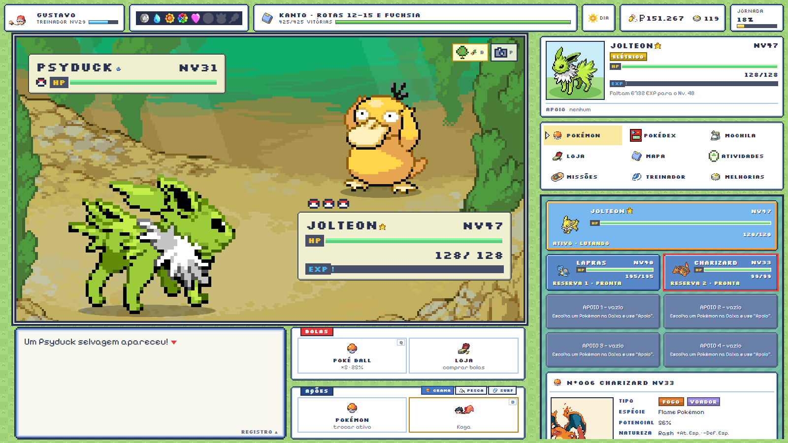

## Sobre o jogo

- **Uma abertura com história**: tela de "Pressione Start", o Prof. Carvalho apresentando o mundo, e a
  escolha do inicial no laboratório, com o rival da região levando o que tem vantagem sobre o seu.
- **6 regiões** (Kanto, Johto, Hoenn, Sinnoh, Unova e Kalos), **96 áreas**, **48 ginásios**, Elite Four e
  Campeão em cada uma. Kalos é o pós-jogo: tudo no nível 100, com selvagens e líderes reforçados.
- **668 espécies** das Gerações I a VI, com sprites no estilo Black/White (frente, costas e shiny): animados
  até a Geração V e na maior parte da VI; o resto da VI usa os sprites estáticos do mesmo estilo.
- **Batalha automática** em tempo real, com tipos, habilidades, itens segurados, status, clima e dia/noite.
- **Progresso offline**: ao voltar, um relatório mostra o que a equipe fez enquanto você estava fora.
- **Muito para fazer em paralelo**: creche, expedições, jardim, raides, torneio semanal, Safari, Torre de
  Batalha, pesca e Surf, mercador viajante, caça ao shiny e mais.

## Capturas de tela

|                                               |                                             |
| --------------------------------------------- | ------------------------------------------- |
| 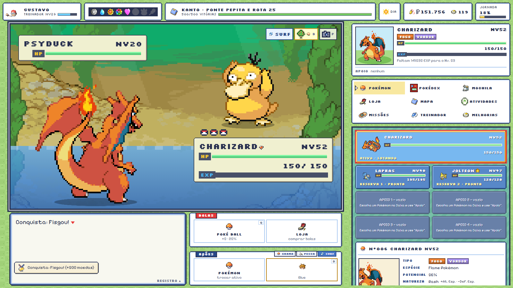 | 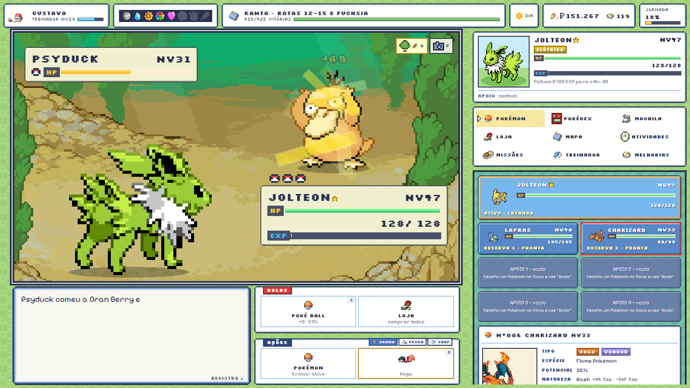 |
| Surf: encontros de água com espécies próprias | A equipe de 6 e a ficha de cada Pokémon     |
| 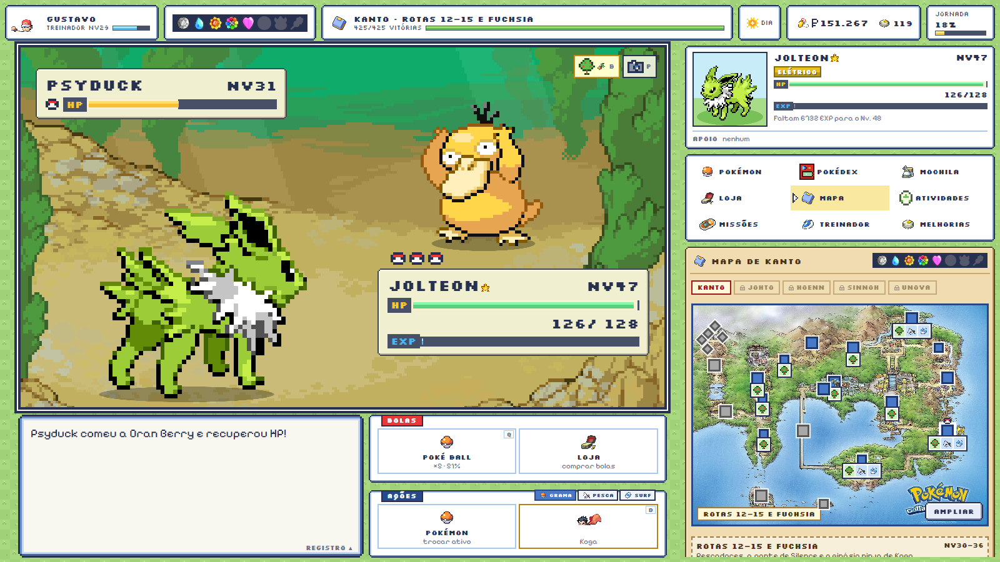                 | 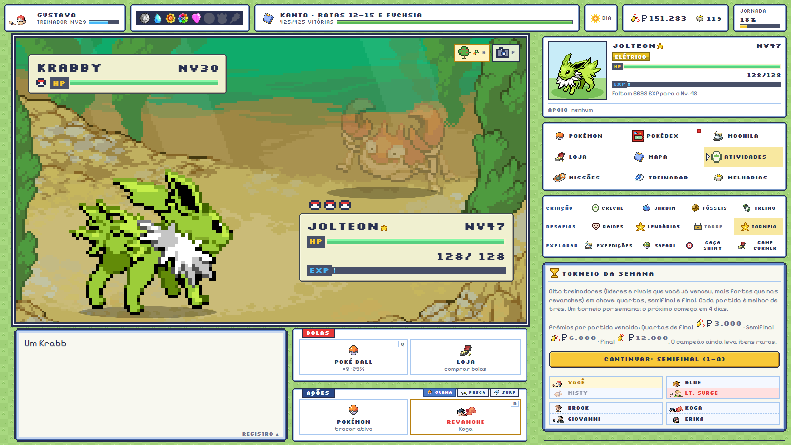         |
| Mapa oficial de cada região com marcadores    | Torneio semanal em chave de 8               |
| 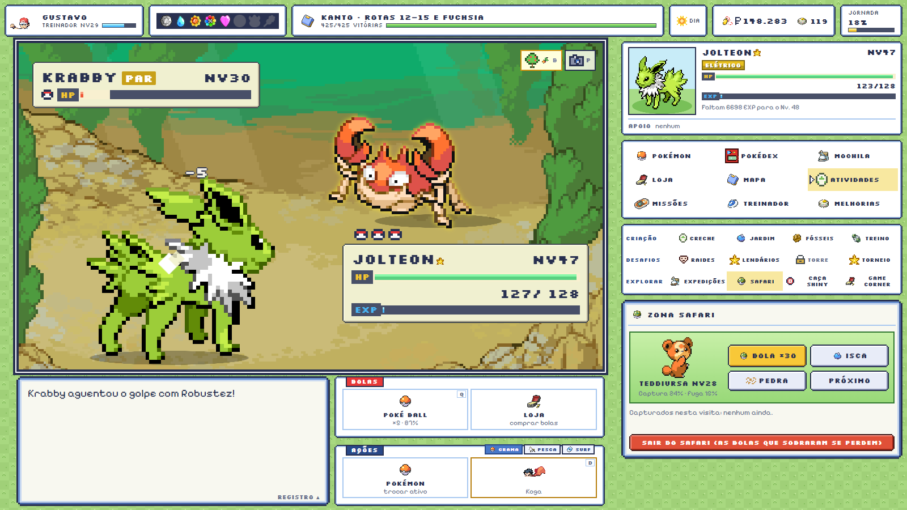             | 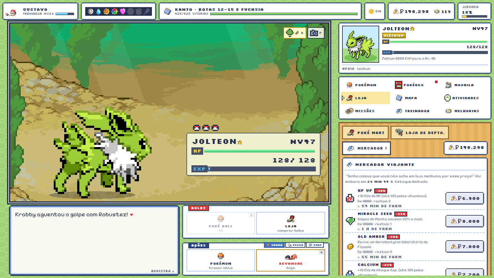               |
| Jogo do Safari: bola, isca ou pedra           | Mercador viajante com estoque limitado      |
| 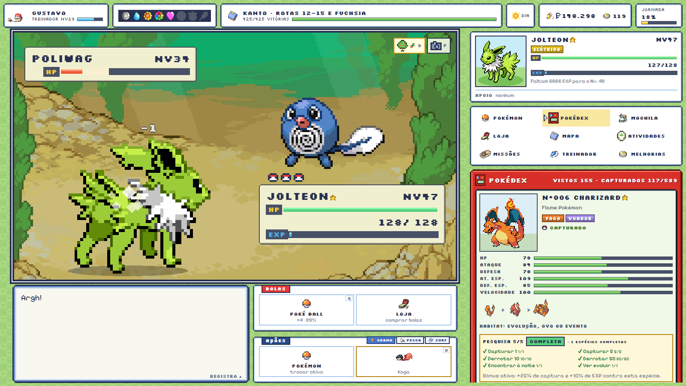           | 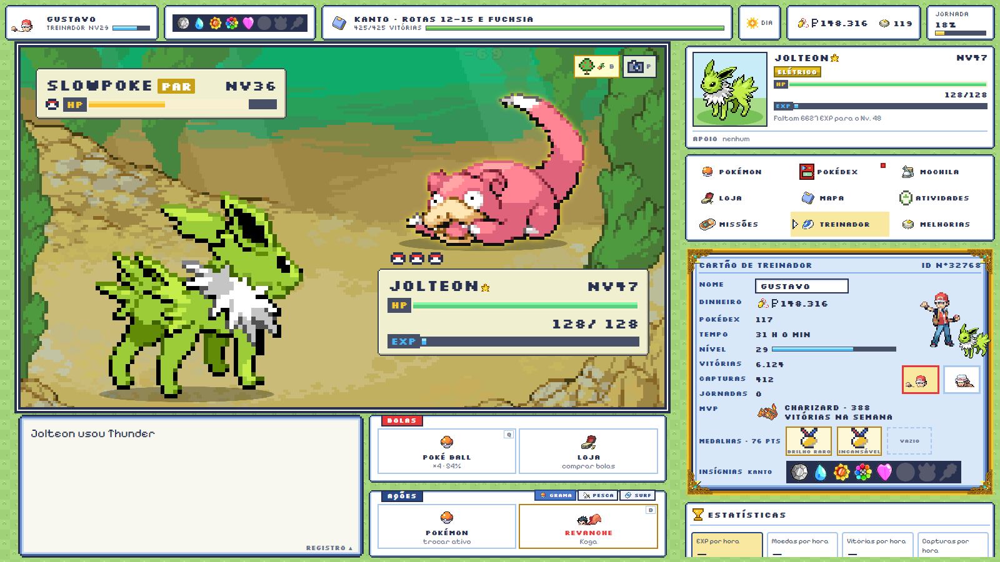     |
| Pokédex com diário de pesquisa por espécie    | Cartão de treinador com medalhas e moldura  |

## Funcionalidades

### Abertura

|                                              |                                                      |                                                         |
| -------------------------------------------- | ---------------------------------------------------- | ------------------------------------------------------- |
| 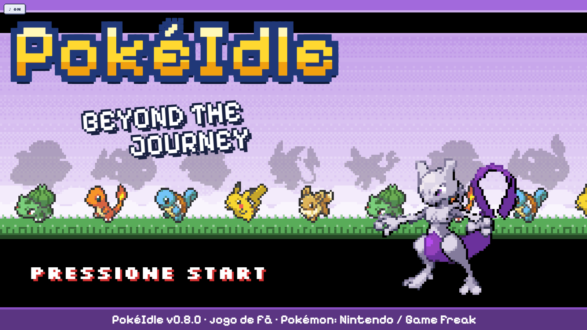 | 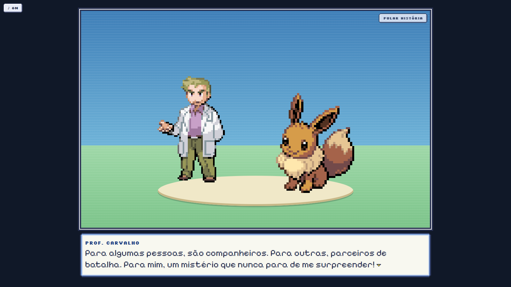                  | 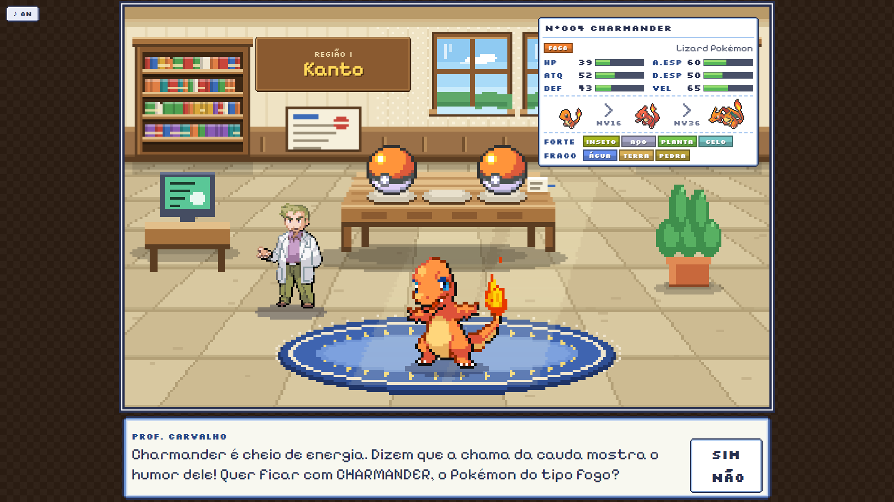             |
| Tela de título com o lendário de cada região | O professor apresenta o mundo e pergunta quem é você | Abra uma Poké Bola, conheça o inicial e diga SIM ou NÃO |

- Tela de "Pressione Start" em tela cheia, no estilo das telas de título de GBA, e menu com CONTINUAR (com a
  ficha do save), NOVO JOGO e CARREGAR JOGO (código de transferência ou arquivo, direto do início).
- Prólogo com o Prof. Carvalho: o mundo, as seis regiões, a ideia de progresso com o jogo fechado, avatar,
  nome e o aviso sobre o rival. Dá para pular a história.
- Laboratório: três Poké Bolas por região (setas na placa da parede trocam a região). A bola se abre, o
  Pokémon aparece com o grito e uma frase do professor, e a ficha mostra atributos, evoluções e vantagens.
  Depois do SIM, dá para dar um apelido, e o rival da região chega para levar a bola com vantagem.
- Tema musical próprio na abertura (com botão para desligar) e a placa da Rota 1 ao entrar no jogo.

### Batalha e campanha

- Combate automático com fórmulas de dano, precisão e captura da 3ª geração, 25 naturezas, IVs e EVs.
- 69 habilidades (Intimidação, Robustez, Levitação...) e 42 itens seguráveis (Sobras, Faixa Escolha, Orbe da
  Vida, berries...).
- Status (queimadura, veneno, paralisia, sono, congelamento) com as imunidades de tipo dos jogos.
- Equipe de até 6 Pokémon, em ordem: o 1º luta, os outros entram quando ele desmaia (ou quando têm vantagem de
  tipo) e todos dão um bônus pelo tipo. Monta e reordena direto na tela POKéMON.
- Clima pelo relógio real (sol, chuva, tempestade de areia, neblina, granizo) e dia/noite; algumas espécies
  só aparecem em certos horários e climas.
- Líderes de ginásio dão insígnia e TM; o rival fica mais forte a cada nova jornada; o Campeão registra a
  equipe no Hall da Fama e libera a próxima região.

### Coleção

- Captura manual e automática, Pokédex com filtros e diário de pesquisa por espécie (completar dá bônus de
  captura e EXP contra ela).
- Evolução por nível, pedras e outros itens, amizade e condição (Tyrogue, Wurmple).
- Formas colecionáveis: as 28 letras do Unown, Deerling/Sawsbuck nas quatro estações, Castform pelo clima e
  os padrões de manchas do Spinda.
- 60 lendários e quase lendários, enfrentados numa batalha manual depois de vencer o Campeão da região. Depois de
  capturado, cada um volta (um dia depois; os quase lendários, em 6 horas) para quem quiser outro exemplar.
- Pesca (Old, Good e Super Rod) e Surf em 21 áreas com água, com espécies que não aparecem na grama.
- Jogo do Safari com espécies exclusivas: Chansey, Scyther, Pinsir, Tauros, Heracross, Dratini...

### Atividades

| Grupo    | Atividades                                                                       |
| -------- | -------------------------------------------------------------------------------- |
| Criação  | Creche e ovos, jardim de berries, laboratório de fósseis, Campo de Treino (EVs)  |
| Desafios | Raides com chefes gigantes, lendários, Torre de Batalha e Torre semanal, torneio |
| Explorar | Expedições de 1, 4 ou 8 horas, Safari, caça ao shiny, Game Corner                |

Também há errantes, a Equipe Rocket, revanches contra líderes, árvores de berry nas rotas, missões diárias e
semanais, e um Pokémon acompanhante que ganha amizade com o tempo e às vezes acha itens.

### Cabo Link

Troca e duelo entre amigos por código de texto, sem servidor (o mesmo formato do código de transferência).

- **Troca**: o Pokémon escolhido sai do jogo de quem envia e entra no de quem cola o código, com IVs, natureza,
  golpes, item e apelido. O mesmo código não entra duas vezes, e um envio pode ser cancelado. Kadabra, Machoke,
  Graveler, Haunter e as outras evoluções por troca acontecem na chegada.
- **Duelo fantasma**: o código leva a equipe; quem o cola enfrenta essa equipe numa batalha com os dois
  lados na mesma força (sem bônus da equipe, medalhas ou desafios). A primeira vitória contra cada equipe paga um
  prêmio, e o placar fica guardado.

### TMs

- Estojo com os 87 TMs numerados (TM01 é o Rock Tomb do Brock), mostrando onde conseguir os que faltam.
- Ensino direto pela Mochila: escolha quem aprende e qual golpe sai.
- Prateleira de TMs na Loja de Departamentos de Celadon; os golpes mais fortes chegam depois de certos ginásios, e
  os TMs dos líderes de uma região entram depois do Campeão dela.

### Progressão de longo prazo

- Bônus da equipe: cada Pokémon dá um bônus pelo tipo (dano, EXP, moedas, captura...), com retorno decrescente.
- Laboratório: duplicatas e espécies novas viram pontos de pesquisa para bônus permanentes.
- Maestria por linha evolutiva, prestígio (nova jornada com pontos para melhorias) e desafios opcionais:
  Lobo solitário, Mochila vazia, Natureza feroz e Nuzlocke (só a primeira captura de cada área vale, e quem
  desmaia contra treinadores fica fora da jornada).
- Torre semanal: toda segunda-feira, um tipo obrigatório para a equipe e um modificador (Feroz, Sem descanso,
  Direto ao topo…). Os andares saem de uma semente da semana, então são iguais para todos e dá para comparar.
- Equipes salvas: até seis equipes com os itens, trocadas com um clique. Ligada a um desafio
  (ginásios, raides, Torre, torneio, lendários, duelo), a equipe entra sozinha e a de antes volta no fim.
- Regras de automação (tela Treinador): capturar bons exemplares (potencial mínimo, habilidade oculta,
  naturezas), formas que faltam ou tudo com Poké Ball comum; transferir os repetidos que sobram; colher e
  replantar o jardim; resgatar missões.
- Caixa com busca, filtros (tipo, etiqueta, shiny, perfeitos, repetidos), favoritos protegidos de
  transferência, seis etiquetas com nome editável e seleção múltipla para etiquetar ou transferir em lote.
- 47 medalhas em bronze, prata, ouro e platina, com vitrine e molduras para o cartão de treinador.
- Visual do treinador: Red, Leaf, Brendan ou May (os dois de Hoenn também com a roupa de Ruby/Sapphire) e
  13 cores para cada peça de roupa (boné, jaqueta, camisa, calça ou saia). A roupa aparece no HUD, no cartão
  e, pelo Cabo Link, nos duelos fantasma dos amigos.
- Economia com Poké Mart, Loja de Departamentos de Celadon, venda de itens e mercador viajante. A loja mostra
  quanto tempo de jogo cada preço representa no seu ritmo atual.

### Qualidade de vida

- Painel de próximos passos na coluna do menu: o que está pronto, o que acaba logo e o que está parado, com a
  chance estimada contra o próximo chefe e a ação a um clique.
- Relatório offline e atalhos de teclado.
- **AJUDA** (`ajuda.html`): uma página separada, aberta em outra aba do navegador (pelo menu AJUDA, pela tecla `H` ou
  pelo COMO JOGAR da tela inicial), com um FAQ de mais de 60 perguntas explicadas do zero, com busca, assuntos e
  imagens que ampliam, para quem nunca jogou. O conteúdo fica em `src/ui/help/content`.
- Notificações do sistema com o jogo em segundo plano, por categoria (creche, expedições, visitantes,
  progresso, shiny), agrupando avisos repetidos.
- Layout de uma coluna para celular, com o menu como barra de abas, e PWA instalável que abre sem internet.
- Primeiros passos guiados: nos primeiros minutos, o professor dá uma dica por vez na caixa de mensagens da
  batalha (o selvagem, a Poké Ball, a Caixa, a barra da rota, o progresso offline).
- O professor volta a falar a cada região liberada, com o lendário dela em silhueta.
- Apelidos: o inicial pode ganhar um no laboratório, e qualquer Pokémon pode ser renomeado na ficha.
- Espaços trancados da equipe aparecem um de cada vez: só o próximo a liberar fica visível.
- Tema de batalha contra chefes e fanfarra ao ganhar uma insígnia ou entrar no Hall da Fama.
- Cada atividade aparece como NOVA quando é liberada e mostra uma dica na primeira visita.
- Histórico de cada Pokémon e MVP da semana; fotos da batalha em PNG com legenda.
- Opções de acessibilidade: contraste alto, texto maior, velocidade das animações e "Reduzir animações"
  (ligado de início se o sistema pede menos movimento), links para pular ao menu e à tela aberta, e alvos de
  toque maiores em telas sensíveis ao toque.

## Controles

| Tecla     | Ação                                                           |
| --------- | -------------------------------------------------------------- |
| `1` a `9` | Abrir as telas do menu                                         |
| `Q`       | Lançar Poké Ball                                               |
| `W`       | Lançar Great Ball ou Ultra Ball                                |
| `D`       | Desafiar o chefe, a raide, a Equipe Rocket ou fazer a revanche |
| `F`       | Fugir ou desistir do desafio                                   |
| `E`       | Alternar entre grama, pesca e Surf (em áreas com água)         |
| `M`       | Mega Evoluir (modo manual, com a Mega Stone)                   |
| `H`       | Abrir a AJUDA                                                  |
| `B`       | Colher a árvore de berry da área                               |
| `P`       | Tirar uma foto da batalha                                      |
| `Esc`     | Fechar avisos e relatórios                                     |

Na abertura: qualquer tecla passa da tela de "Pressione Start"; no laboratório, `←` `→` escolhem a bola, `↑`
`↓` trocam a região, `Enter` ou `Z` abrem e confirmam, e `Esc` ou `X` respondem NÃO.

A lista também aparece no jogo, na tela Treinador.

## Rodando localmente

**Requisitos:** Node.js 22 (ou 20.19+). Para o aplicativo desktop: Rust e `cargo-tauri`.

```bash
npm install
npm run dev           # abre em http://localhost:5173
```

| Comando               | O que faz                                                               |
| --------------------- | ----------------------------------------------------------------------- |
| `npm run dev`         | Servidor de desenvolvimento                                             |
| `npm test`            | Testes (regras do jogo, save, offline, motor e interface)               |
| `npm run lint`        | ESLint                                                                  |
| `npm run typecheck`   | Checagem de tipos                                                       |
| `npm run build`       | Gera `dist/` com caminhos relativos                                     |
| `npm run balance`     | Relatório de balanceamento (ritmo da campanha e dificuldade das raides) |
| `npm run tauri:dev`   | Aplicativo desktop com recarga automática                               |
| `npm run tauri:build` | Executável e instalador NSIS em `src-tauri/target/release/`             |

## Dados e assets

O conteúdo de espécies, golpes, tipos e itens vem da [PokéAPI](https://pokeapi.co) e já está no repositório.
Para gerar de novo:

```bash
npm run data:fetch            # usa o cache em scripts/.cache
npm run data:fetch -- --fresh # baixa tudo de novo
```

| Origem            | O quê                                                                                              |
| ----------------- | -------------------------------------------------------------------------------------------------- |
| PokéAPI           | Dados das espécies e golpes, sprites animados de Black/White, ícones, itens, insígnias e gritos    |
| pret/pokeemerald  | Arte de Brendan e May (roupas de Emerald e de Ruby/Sapphire), em 80×80 com fundo transparente      |
| Pokémon Showdown  | Sprites de treinadores (estilo FireRed/LeafGreen) e fundos de batalha ilustrados                   |
| Bulbapedia        | Arte oficial dos mapas de cada região                                                              |
| Feito para o jogo | Cenários alternativos, molduras, ícones de interface, efeitos de batalha, música e efeitos sonoros |

Os padrões de manchas do Spinda não têm sprite pronto: o jogo recolore o sprite base num canvas
(`src/ui/spinda.ts`), como os jogos fazem.

As artes geradas para o jogo ficam em `art/` e passam por scripts antes de entrar em `public/`:

| Script                              | Uso                                                                    |
| ----------------------------------- | ---------------------------------------------------------------------- |
| `python scripts/sprite-feet.py`     | Mede onde ficam os pés de cada sprite, para alinhar o Pokémon à sombra |
| `python scripts/weather-sprites.py` | Converte as artes de clima de `art/weather/` em folhas transparentes   |
| `python scripts/frame-corners.py`   | Converte os ornamentos das molduras de `art/frames/`                   |

Os scripts em Python precisam do [Pillow](https://pypi.org/project/pillow/).

## Arquitetura

```
src/
  game-data/   conteúdo orientado por dados: regiões, rotas, balanceamento, habilidades,
               itens, água, formas, Safari, conquistas (e os JSON gerados da PokéAPI)
  core/        regras do jogo, puras e testáveis, sem React
  engine/      loop de passo fixo (100 ms), autosave e armazenamento do save
  ui/          interface React: batalha, telas, componentes, textos, sons e estilos
src-tauri/     casca desktop (Tauri 2): save em arquivo e notificações
scripts/       geração de dados, balanceamento e conversão de artes
art/           artes de origem (não vão para o jogo sem passar pelos scripts)
```

- A simulação é determinística: um gerador de números aleatórios com estado salvo e passo fixo fazem a mesma
  semente dar sempre o mesmo resultado.
- As regras em `core/` não conhecem a interface; elas mudam o estado e devolvem eventos, que a interface
  transforma em animações, textos e sons.
- O progresso offline é uma função pura, separada do loop visual.
- Os números de balanceamento ficam em `src/game-data/balance.ts`; o conteúdo do mundo, em
  `scripts/world.mjs`.

## Save

- **Navegador:** `localStorage` (como PWA, o mesmo armazenamento).
- **Desktop:** arquivos JSON em `%APPDATA%\com.pokeidle.beyondthejourney\saves\`, gravados de forma atômica,
  com um backup por dia (os 7 mais recentes).

O save é versionado e saves antigos são migrados automaticamente. O save anterior fica como backup e é
restaurado se o principal estiver corrompido.

Para levar o jogo a outro navegador ou computador, use Treinador > Salvar e transferir: o código de
transferência (`PKI1.…`) é o save comprimido com gzip e um checksum que recusa códigos cortados ou
alterados. Também dá para baixar e abrir o mesmo código como arquivo `.pkidle`, inclusive direto da tela
inicial (CARREGAR JOGO), sem precisar começar uma jornada antes. Textos exportados por versões
anteriores continuam sendo aceitos.

## Testes e balanceamento

A suíte (Vitest) cobre combate, captura, evolução, todas as atividades, o progresso offline, migrações de save,
o motor e um teste de fumaça da interface. Um dos testes simula a campanha com cada inicial e falha se o
começo ficar trivial ou impossível. `npm run balance` mostra os minutos por área e a taxa de vitória nas raides.

## Estado do projeto

Em desenvolvimento. Ainda faltam:

- Seletor de idioma (hoje o jogo está só em português).
- Testar o instalador do aplicativo desktop.

## Aviso legal

Projeto de fã, sem fins lucrativos e sem relação com a Nintendo, a Game Freak, a Creatures ou a The Pokémon
Company. Pokémon e todos os nomes, sprites e sons relacionados são marcas e propriedade desses detentores.
